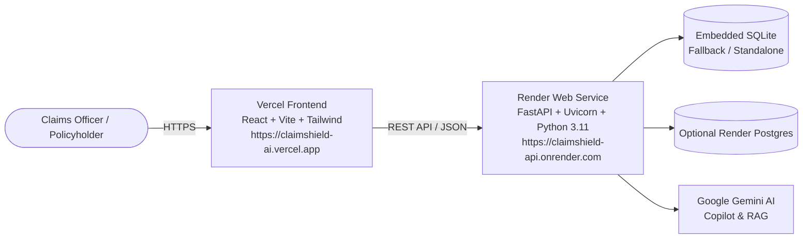

# ClaimShield AI — Production Deployment Guide
**Institutional Fraud Detection & Investigation Suite**

This guide provides step-by-step instructions for deploying ClaimShield AI across **Render** (Backend API & Services) and **Vercel** (Frontend Institutional BFSI Interface).

---

## Architecture Overview

---

## Part 1: Deploy Backend on Render

The backend is built with FastAPI and runs on Python 3.11.9 with PyMuPDF for document forensic OCR and deterministic 10-rule scoring.

### Option A: 1-Click Render Blueprint (Recommended)

1. Sign in to your [Render Dashboard](https://dashboard.render.com).
2. Click **New +** in the top navigation and select **Blueprint**.
3. Connect your GitHub repository: `https://github.com/AvdheshCodes/claimshield-ai`.
4. Render will automatically read `render.yaml` from the repository root:
   - **Service Name:** `claimshield-api`
   - **Runtime:** `Python 3.11.9`
   - **Root Directory:** `backend`
   - **Build Command:** `pip install --upgrade pip && pip install -r requirements.txt`
   - **Start Command:** `uvicorn app.main:app --host 0.0.0.0 --port $PORT`
   - **Health Check Path:** `/api/health`
5. Click **Apply**.
6. In the service settings, add your optional secret keys under **Environment**:
   - `GEMINI_API_KEY`: *(Your Google AI Gemini API Key for copilot RAG)*
7. Once deployed, copy your Render Web Service URL (e.g., `https://claimshield-api.onrender.com`).

---

### Option B: Manual Web Service on Render

If creating manually without Blueprint:
1. Click **New +** -> **Web Service**.
2. Connect your repository.
3. Configure settings:
   - **Name:** `claimshield-api`
   - **Region:** Singapore / Frankfurt / Oregon (nearest to you)
   - **Branch:** `development` (or `main`)
   - **Root Directory:** `backend`
   - **Runtime:** `Python 3`
   - **Build Command:** `pip install --upgrade pip && pip install -r requirements.txt`
   - **Start Command:** `uvicorn app.main:app --host 0.0.0.0 --port $PORT`
4. Add Environment Variables:
   - `PYTHON_VERSION`: `3.11.9`
   - `JWT_SECRET`: *(Click Generate or enter 32+ character random string)*
   - `GEMINI_API_KEY`: *(Your Gemini key)*
   - `UPLOAD_DIR`: `uploads`
5. Click **Create Web Service**.
6. Verify deployment by opening `https://<your-service>.onrender.com/api/health` in your browser. You should see `{"status":"healthy","service":"InsureGuard AI","version":"2.0.0"}`.

---

## Part 2: Deploy Frontend on Vercel

The frontend is a Vite + React + TypeScript single-page application configured with clean BFSI tokens and SPA routing rewrites.

### Steps to Deploy on Vercel

1. Log in to your [Vercel Dashboard](https://vercel.com).
2. Click **Add New...** -> **Project**.
3. Select and import your GitHub repository: `AvdheshCodes/claimshield-ai`.
4. In the **Configure Project** screen:
   - **Project Name:** `claimshield-ai`
   - **Framework Preset:** `Vite`
   - **Root Directory:** Click **Edit** and select `frontend`.
   - **Build and Output Settings:** Leave default (`npm run build` / `dist`).
5. **Environment Variables**:
   - Expand the **Environment Variables** section.
   - Add:
     - **Key:** `VITE_API_URL`
     - **Value:** `https://claimshield-api.onrender.com` *(Replace with your actual Render URL from Part 1, without a trailing slash)*
6. Click **Deploy**.
7. Vercel will install dependencies, compile the TypeScript bundle, and provide your live URL (e.g. `https://claimshield-ai.vercel.app`).

---

## Part 3: Live Verification Checklist

Once both services are active:

| Verification Item | Test Procedure | Expected Result |
| :--- | :--- | :--- |
| **Backend Health** | Open `https://<render-url>/api/health` | HTTP 200 `{"status": "healthy"}` |
| **Frontend Gateway** | Visit `https://<vercel-url>/login` | Institutional Dual-Dialog Gateway renders |
| **Investigator Login** | Click `Demo Investigator` -> Sign In | Lands on Claims Overview (`/investigator`) |
| **Policyholder Login** | Click `Demo Policyholder` -> Sign In | Lands on Policyholder Portal (`/customer`) |
| **Evidence Upload & OCR** | Submit sample PDFs via intake | Deterministic scoring and OCR extract |
| **Court Dossier Export** | Click `Export Dossier (PDF)` | PDF downloads with forensic headers |
| **Direct Navigation** | Refresh browser on `/investigator` | Vercel rewrites maintain route without 404 |

---

## Default Seeded Accounts

For testing or client demonstrations, the database pre-seeds these accounts:

- **Senior Claims Investigator:**
  - Email: `investigator@insureguard.ai`
  - Password: `investigator123`
- **Risk Governance Admin:**
  - Email: `admin@insureguard.ai`
  - Password: `admin123`
- **Policyholder:**
  - Email: `customer@insureguard.ai`
  - Password: `customer123`
