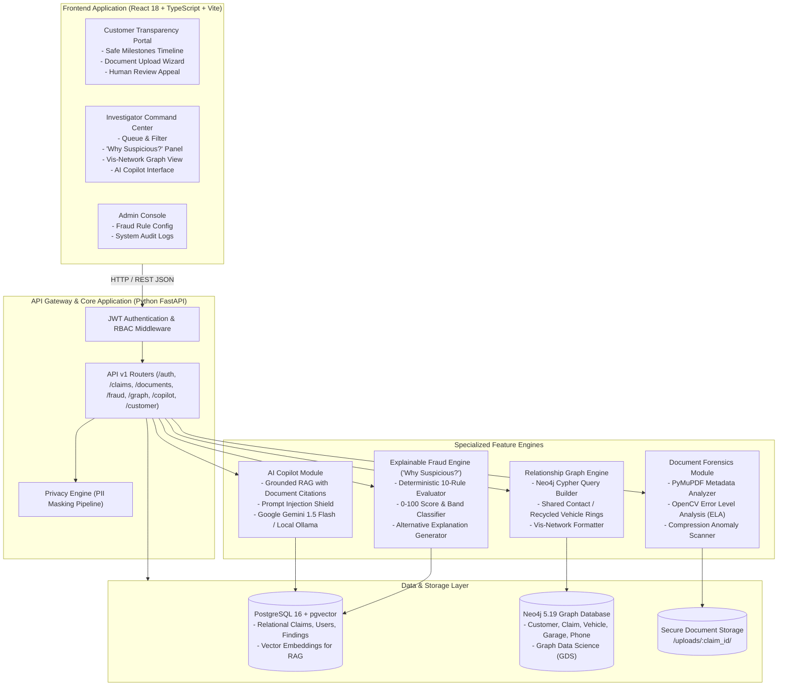
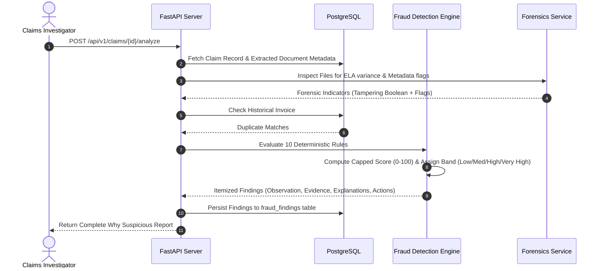
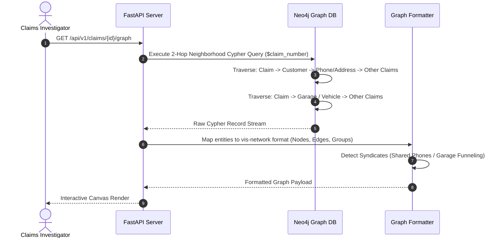
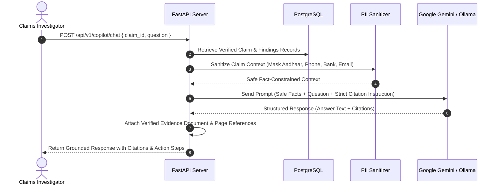
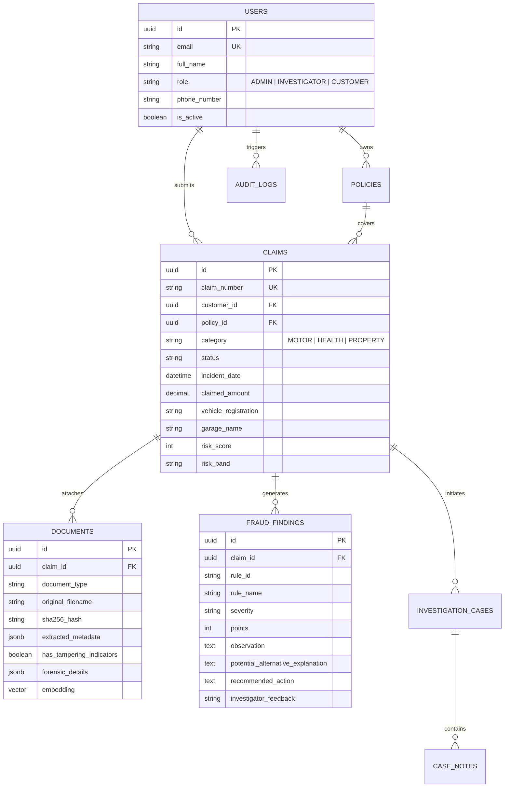

# InsureGuard AI — Final System Architecture Specification

**Document Version:** 3.0 (Master Blueprint)  
**System Type:** Decoupled Intelligence & Forensic Platform  
**Target:** Modular Independent Development with Seamless Mainline Integration  

---

## 1. High-Level Modular Architecture

---

## 2. Special Features: Data Pipelines & Sequence

### 2.1 The "Why Suspicious?" Evaluation Pipeline

---

### 2.2 The Fraud Relationship Graph Pipeline

---

### 2.3 The Privacy-First AI Copilot Pipeline

---

## 3. Database Entity Relationship (PostgreSQL)

---

## 4. Neo4j Graph Model Definition

### Nodes:
- `(:Customer {id, name, risk_tag})`
- `(:Claim {claim_number, amount, date, status, risk_score})`
- `(:Vehicle {registration, make, model})`
- `(:Garage {name, license, location})`
- `(:Hospital {name, registration})`
- `(:Phone {number})`

### Edges:
- `(:Customer)-[:SUBMITTED]->(:Claim)`
- `(:Customer)-[:OWNS]->(:Vehicle)`
- `(:Claim)-[:INVOLVES_VEHICLE]->(:Vehicle)`
- `(:Claim)-[:REPAIRED_AT]->(:Garage)`
- `(:Claim)-[:TREATED_AT]->(:Hospital)`
- `(:Customer)-[:SHARES_CONTACT]->(:Phone)`

---

## 5. Security & Isolation Architecture

1. **Token Authentication:** Bearer JWT with HMAC-SHA256. Roles enforced on FastAPI routers via `get_current_user` dependency.
2. **Customer Isolation:** Customer endpoints query solely by `WHERE customer_id == current_user.id`.
3. **Data Masking Layer:** Centralized in `app.services.privacy.pii.PIIMasker`.
4. **Audit Logging:** Every status change and officer finding modification writes an immutable record to `audit_logs`.
