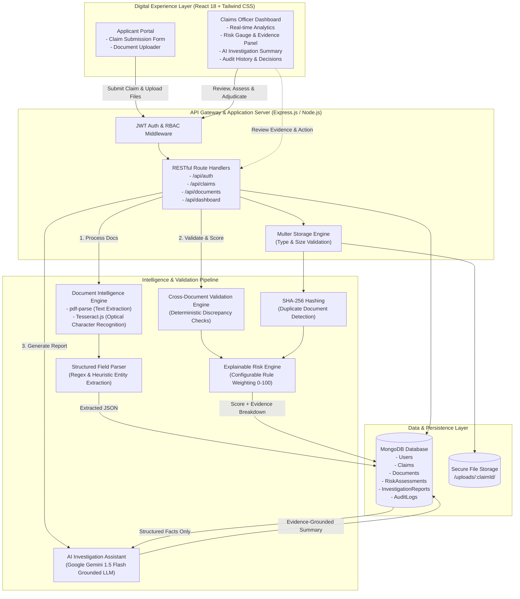
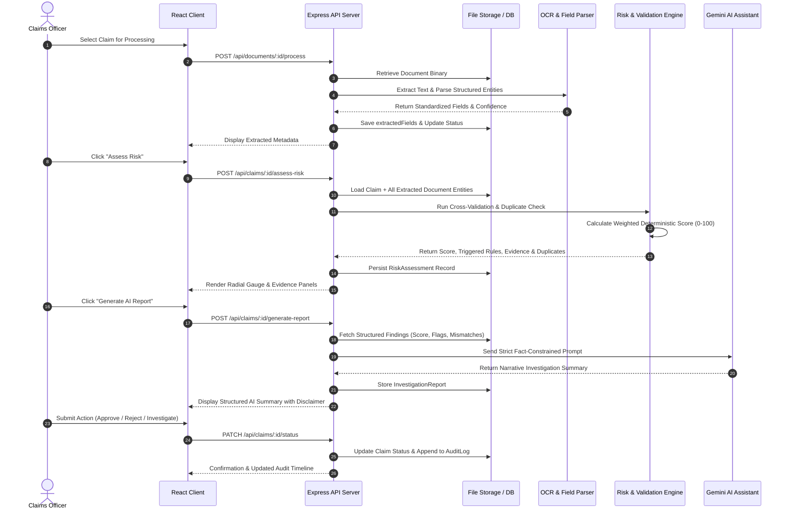

# ClaimShield AI — System Architecture & Design Specification

> **Event:** Visionet Techthon 2026 — Round 2  
> **Team:** Avdhesh (Backend Lead), Ayush (Frontend Lead), Manaswi (AI Lead)  
> **Target:** Intelligent Insurance Claims Processing and Explainable Fraud Detection  

---

## 1. High-Level System Architecture

ClaimShield AI follows an integrated, decoupled MERN architecture augmented with document intelligence and deterministic explainability engines.

---

## 2. End-to-End Data Processing Workflow

The pipeline transforms unstructured claim documents into actionable, evidence-backed decision support:

---

## 3. Logical AI Agent & Component Architecture

In compliance with Visionet Techthon Round 2 guidelines, we explain the discrete responsibilities of each intelligence component, the tools they use, and how they communicate:

| Component | Nature | Primary Responsibility | Input | Tools & Frameworks | Output |
|---|---|---|---|---|---|
| **1. Document Intelligence Engine** | Algorithmic + ML | Extracts text and parses key-value entities from diverse file formats. | Raw PDF / Image files | `pdf-parse`, `tesseract.js`, Regex Heuristics | Structured JSON with confidence metrics |
| **2. Deduplication Module** | Cryptographic & Database | Identifies identical files and recycled invoice numbers across all historical claims. | File buffers, parsed invoice numbers | Node.js `crypto` (SHA-256), MongoDB indexed queries | Matching document/claim references |
| **3. Cross-Document Validation Engine** | Deterministic Rule-Based | Compares key entities across documents (e.g. Policyholder, Registration, Dates, Amounts). | Extracted fields from all attached documents | Deterministic validation algorithms | List of pass/fail/warning checks with evidence |
| **4. Explainable Risk Scoring Engine** | Deterministic Formula | Calculates reproducible risk scores (0-100) and categorizes claim priority. | Triggered rules, mismatch details, duplicate records | Weighted scoring matrix, threshold classifiers | Risk score, category, itemized rule breakdown |
| **5. AI Investigation Assistant** | Generative LLM | Synthesizes complex validation results into an executive investigation brief for humans. | Structured JSON findings ONLY (no raw hallucinated inputs) | Google Gemini 1.5 Flash (`@google/generative-ai`) | 7-part structured narrative summary |
| **6. Human Review & Audit Layer** | Decision Support | Enables human-in-the-loop oversight and maintains immutable historical logs. | Officer notes and final disposition | Mongoose `AuditLog` schema | Auditable chronological record |

---

## 4. Key Architectural Decisions & Trade-Offs

1. **Why Deterministic Scoring over Pure Machine Learning for Risk:**
   - *Insurance Regulation & Explainability:* Insurance compliance mandates explainability. A "black-box" neural network cannot tell a claims officer or regulatory auditor exactly which document discrepancy caused a claim to be flagged.
   - *Deterministic Reproducibility:* The exact same claim documents will always produce the exact same score and evidence breakdown.

2. **Why Constrained Prompting for Gemini AI:**
   - The LLM is strictly prohibited from making fraud verdicts or creating independent assertions.
   - It acts purely as a narrative assistant, summarizing verified mathematical and rule-based findings into human-readable briefs.

3. **Stateless Authentication:**
   - JWT tokens with 7-day expiry and bcrypt password hashing ensure compatibility with scalable serverless or containerized cloud deployments (e.g., Render, AWS ECS, Vercel).
